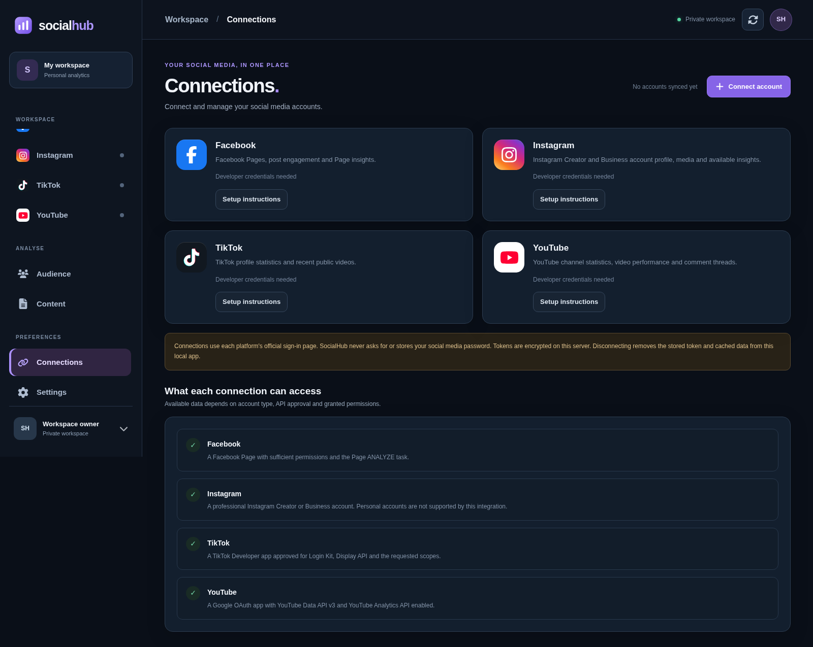
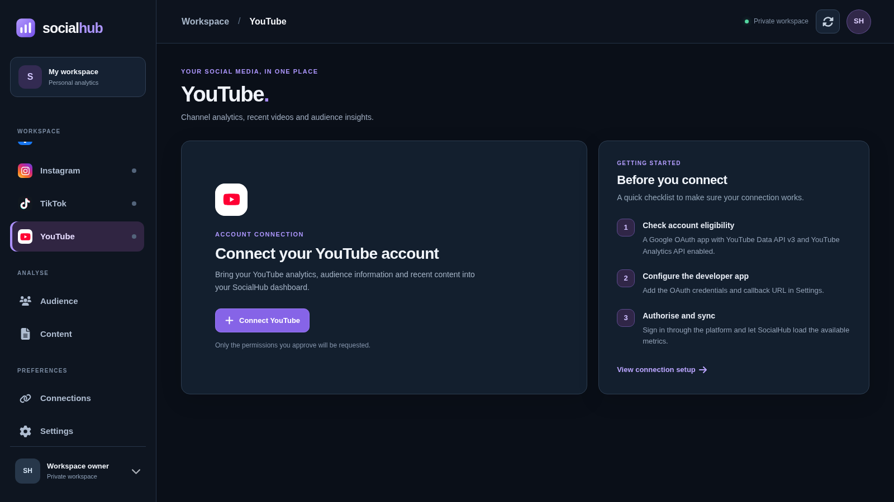
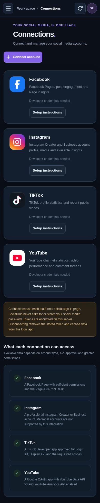
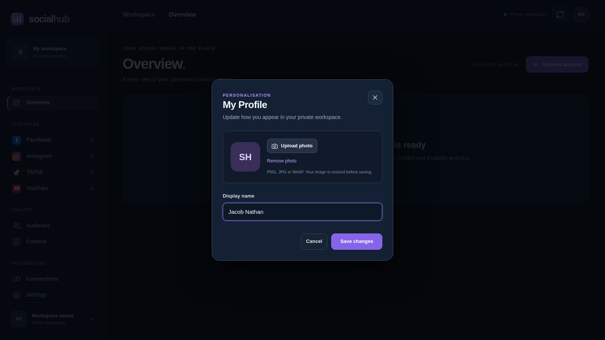

<div align="center">
  

  # SocialHub

  **All your social media, in one place.**

  A private, beautifully designed dashboard for exploring your channels, content and audience.

  <p>
    
    
    
    
  </p>

  **🌐 [Open the live website](https://social-hub-bjt.pages.dev/)**

  **[Explore features](#features) · [Get started](#getting-started) · [Connect platforms](#social-platforms) · [Deployment guide](docs/SETUP.md)**
</div>

---

## Take a look

<p align="center">
  
</p>
<p align="center"><sub>Connections dashboard · Real platform APIs, where credentials and permissions are configured</sub></p>

<table>
  <tr>
    <td width="65%"></td>
    <td width="35%"></td>
  </tr>
  <tr><td align="center"><sub>Platform-specific dashboards</sub></td><td align="center"><sub>Responsive on mobile</sub></td></tr>
</table>

<details>
<summary><b>See the profile editor</b></summary>
<br>

</details>

## Features

| | Capability | What's included |
|:--:|---|---|
| 📊 | **One unified workspace** | Overview, platform dashboards, Audience, Content, Connections and Settings. |
| 🔗 | **Official integrations** | OAuth-based account connections with Facebook Pages, Instagram professional accounts, TikTok and YouTube, subject to permissions and API approval. |
| 📈 | **Analytics & content** | Available audience insights, trends, account metrics, video/post ranking and comments where supported by the provider. |
| 👤 | **Profile personalisation** | Change your display name and photo from either the sidebar or top-right profile menu. |
| 🎨 | **Modern dark UI** | Spacious layouts, full-width navigation, consistent Font Awesome Free icons, polished platform branding and responsive screens. |
| 📱 | **Installable PWA** | App icon, manifest and service worker for a standalone app experience on supported devices. |
| 🔐 | **Private by design** | Owner-password login, encrypted OAuth token storage and server-side API credentials. |

> [!NOTE]
> SocialHub is a **single-owner project**, not a public multi-user social network. The screenshots show the disconnected/setup experience, **not** fabricated or live analytics. Available metrics depend on the actual social platform and permissions granted.

## Getting started

**Requirements:** Node.js **20+** and npm.

```bash
git clone https://github.com/JNathan34/Social-Hub.git
cd Social-Hub
npm install
cp .env.example .env
```

Open `.env`, set a unique `APP_PASSWORD` of **at least 16 characters**, then start the server:

```bash
npm start
```

Go to **http://localhost:3000** and sign in with your workspace password.

On Windows, you can also copy `.env.example` to `.env`, set the password and use **`Start-SocialHub.bat`**.

### Docker

```bash
cp .env.example .env  # set APP_PASSWORD in .env before running
docker compose up --build -d
```

For hosted deployments, serve over **HTTPS**, use persistent storage, and configure `APP_URL` correctly. See the [complete setup and deployment guide](docs/SETUP.md).

## Social platforms

| Platform | Account requirements | Server-side environment variables |
|---|---|---|
| **Facebook** | Facebook Page with appropriate permissions | `META_APP_ID`, `META_APP_SECRET` |
| **Instagram** | Creator or Business account, approved scopes | `INSTAGRAM_APP_ID`, `INSTAGRAM_APP_SECRET` |
| **TikTok** | Login Kit Web and Display API access | `TIKTOK_CLIENT_KEY`, `TIKTOK_CLIENT_SECRET` |
| **YouTube** | Google OAuth app, YouTube Data + Analytics API | `GOOGLE_CLIENT_ID`, `GOOGLE_CLIENT_SECRET` |

SocialHub uses the providers' official authentication pages; **never paste social-media passwords or API secrets into the frontend**. Platform scopes, app review and rate limits can restrict which metrics are available.

## Project structure

```text
Social-Hub/
├── public/                  # PWA frontend, icons, styles and JavaScript
├── server.js                # Express backend, sessions and OAuth integrations
├── docs/
│   ├── screenshots/         # Desktop and mobile interface previews
│   └── SETUP.md             # Detailed deployment and integration instructions
├── data/                    # Runtime storage (gitignored)
├── .env.example             # Environment variable template
├── Dockerfile
├── docker-compose.yml
├── render.yaml              # Render deployment blueprint
├── THIRD-PARTY-NOTICES.md
└── package.json
```

## Hosting notes

**GitHub hosts the source code, not the secure backend.** GitHub Pages alone cannot run OAuth callbacks or store tokens; deploy the complete Node/Docker project to a suitable server or hosting platform. The `render.yaml` blueprint and Docker configuration are included.

Keep `.env`, access tokens, and the `data/` directory private. Do not commit real client secrets. Retain your persistent data and encryption keys when upgrading.

## Built with

Node.js · Express · Vanilla JavaScript · HTML/CSS · Progressive Web App APIs · Font Awesome Free icons

See [third-party notices](THIRD-PARTY-NOTICES.md) for icon attribution. Facebook, Instagram, TikTok and YouTube logos belong to their respective trademark owners; SocialHub is not endorsed by those companies.

---

<div align="center">
  <b>SocialHub v1.4.0</b> · Built for a clearer social picture.
</div>
